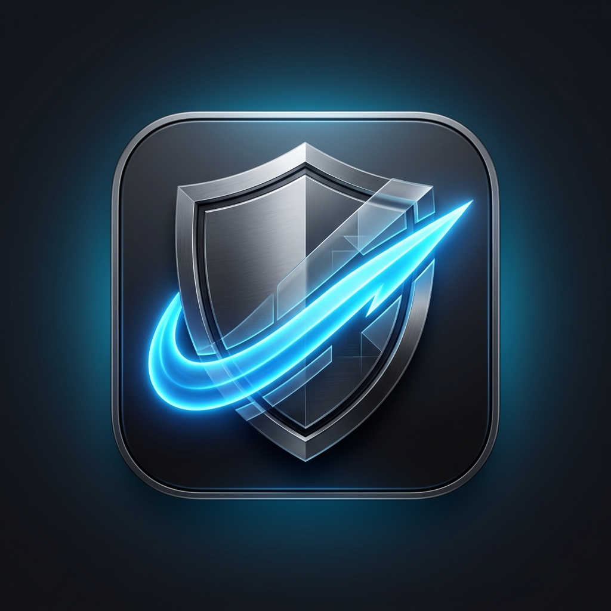

# 🧘‍♂️ ZenMac

> **A safe, minimalist, and beautiful macOS system monitor & storage cleaner.**



ZenMac is a lightweight, Electron-based macOS utility built for users who want to keep an eye on their system stats and safely reclaim storage without risking their system's integrity. Unlike other cleaning utilities that request administrator permissions and run destructive `rm -rf` commands, **ZenMac is designed from the ground up to be safe, transparent, and non-destructive.**

---

## ✨ Features

- **📊 Real-time System Dashboard:** Monitor CPU usage, memory distribution, network speeds, battery health, and disk usage in real time.
- **🧹 Whitelist-Only Cleaner:** Scans only predefined developer caches (npm, yarn, CocoaPods, Gradle, Xcode Derived Data) and standard system logs/caches.
- **🛡️ Sudo-Free Execution:** Barred from running as root to guarantee it can never touch system-protected directories.
- **🗑️ Non-Destructive Cleaning:** Cleaned files are safely moved to the macOS Trash using native APIs, allowing you to easily review and restore them.
- **🎨 Glassmorphism Design:** A stunning dark mode interface matching modern macOS aesthetics with smooth animations and responsive charts.

---

## 🔒 Security Architecture (Why it's safe)

Many system cleaners are essentially "black boxes" running root commands. ZenMac is built on four core safety pillars:

| Pillar | How it works |
| :--- | :--- |
| **No Admin/Sudo** | ZenMac actively checks for `UID === 0` on launch. If run with `sudo`, it exits immediately. |
| **Strict Whitelist** | The scanner has no code path to crawl arbitrary directories. It only scans a hardcoded whitelist of safe temp/cache folders. |
| **Active Blocklist** | An independent, pre-resolved path blocklist prevents operations on critical system directories (`/System`, `/Library`, `/Applications`) and user directories (`~/Documents`, `~/Desktop`, `~/Downloads`). |
| **Native Trash Integration** | ZenMac never executes `rm -rf`. It uses Electron's `shell.trashItem` API to move files to the Trash safely. |

---

## 🚀 Getting Started

### Prerequisites

You need [Node.js](https://nodejs.org/) installed on your Mac.

### Installation

1. Clone this repository:
   ```bash
   git clone https://github.com/yourusername/zenmac.git
   cd zenmac
   ```

2. Install dependencies:
   ```bash
   npm install
   ```

3. Run the application:
   ```bash
   npm start
   ```

---

## 🛠️ Tech Stack

- **Core:** [Electron](https://www.electronjs.org/) (Desktop environment)
- **Stats Engine:** [systeminformation](https://systeminformation.io/) (System data collection)
- **UI & Styling:** Vanilla HTML5, CSS3 (Glassmorphism & animations), and JavaScript.
